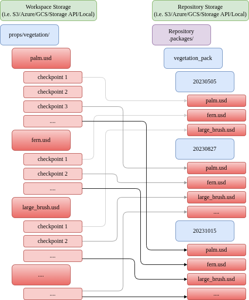

# Create

## Description

Takes package name and version plus either a catalog or a root directory, creates a new package in the repository.

The create command creates a versioned package in an ovpackage repository. It will take a snapshot of the content within the supplied
directory or catalog and copy it to the version in your repository, so anybody installing the package will be certain to get the correct data.
By default, the package is created in the `.packages` folder at the server root.

ovpackage will only capture files, not folders. If your package requires an empty folder, please add a dummy file to the folder.

On creation, ovpackage will scan the source tree for other ovpackage files, and record all files found as subpackages, and store a dependency instead
of the subpackage content itself. Those subpackages must not be "new" packages without an explicit catalog. Otherwise, it's unclear which
files belong to the subpackage versus the top-level package, since the top-level package collects all files not already claimed by a
subpackage anywhere in the source tree. See [Catalog](catalog.md) for creating catalogs to define subpackage boundaries.

For usage examples, see the [Tutorial](../tutorial.md). For CLI options, run `ovpackage create --help`.

## Python API Reference

See the `ovpackage.create` function docstring for the full Python API reference (signature, parameters, and error handling).
