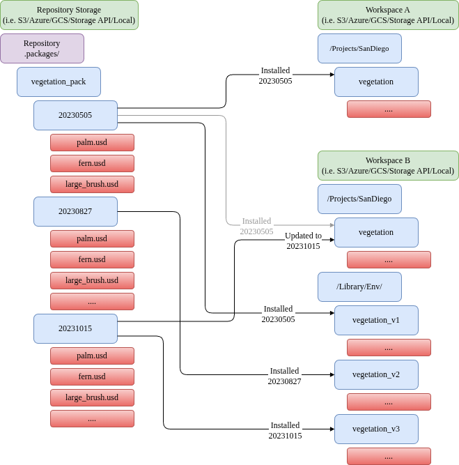

# Install

## Description

Given a package name and version, installs or updates the package's file set at the given destination.

The `install` command is used to make a versioned package available without having the version explicitly in the paths,
making it possible to update to a new package version without updating references to the files in the package.

You can install packages on the same server, different servers, or even your local file system. You can even make multiple versions
of packages available to be used at the same time if needed. The idea here is to not reference the package archive directly from within
the USD files and materials, but rather to create a light-weight copy as a subfolder of the scenario or stage, and that subfolder to have
no version in its path. The version dependency is then maintained with ovpackage.

The `install` command can also be used to update or downgrade a package at the same location to a different version.
For that, just specify a different version number. This command will validate that the installed package is unmodified before installing,
else it will fail with conflicts (to override, just delete the package at the install location and run install again, or you can use the
`create-patch`/`apply-patch` commands).

ovpackage also detects package catalog paths that differ only by letter case, such
as `textures/Foo.psd` and `textures/foo.psd`. Installs to case-insensitive
destinations are refused to prevent one file from overwriting the other, while
installs are allowed when the destination storage reports case-sensitive
behavior. Search for `Cross platform case insensitive path conflicts found` in
the install output or logs when diagnosing this case-only path conflict.

Use `--hash-cache-file` (`--hcf`) to speed up repeated installs by caching file
hashes between runs. See generic parameters for details.
Legacy pickle cache files (ovpackage `<=2.1.0`) are rejected; see [CLI](../cli.md) for JSON format and
one-time migration guidance.

If the source package has SimReady package-standard sidecars, `install` carries
them to the installed `.wrapp` file verbatim, preserving package-standard
identity; it does not create or regenerate sidecars. See
package standard sidecars.

For usage examples, see the [Tutorial](../tutorial.md). For CLI options, run `ovpackage install --help`.

## Python API Reference

See the `ovpackage.install` function docstring for the full Python API reference (signature, parameters, and error handling).
