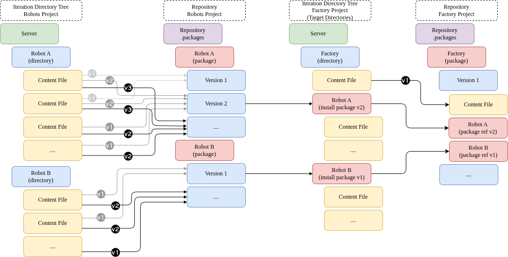

# ovpackage Introduction

## Overview

ovpackage provides a command line tool helping with asset packaging and publishing operations for assets stored
in S3 buckets, Azure containers, GCS buckets, or file systems in a decentralized way.
It encourages a structured workflow for defining the content of an asset package, and methods to publish
and consume those packages in a version-safe manner. ovpackage does not require
a whole-sale shift of your workflow, but instead helps you to migrate to a structured, version managed workflow.

Below is a diagram illustrating the data flow with generic content files using ovpackage. As a new package is created, that specific
content is stored within the package version in the repository. This package can then be installed in new locations as needed.



## Key Points and Assumptions
- ovpackage does not force you into a defined directory structure, it allows the user to define the package structure.
- ovpackage does not modify your files or reference paths in your files. It is assumed, if you want to have your reference versions managed by ovpackage, that the references are all relative within the cataloged directory.
- ovpackage allows for multiple repositories on a single server or across multiple S3 buckets or Storage API services.
- ovpackage allows you to aggregate packages from multiple repositories into "target" directories, and even allows for package dependencies across repositories.
- ovpackage supports creating redirect packages for CDN distribution, allowing package metadata to be served from a CDN while data files remain in the original storage location.

```{warning}
Running an ovpackage write operation concurrently with any other ovpackage operations on the same data can lead to undefined behavior.
Avoid overlapping writes on the same paths; serialize write operations per repository/package path.
```

## Supported Storage Systems

ovpackage supports the following storage systems:

- **S3** — Amazon S3 and compatible object storage (via boto3)
- **Azure Blob Storage** — Microsoft Azure containers and blobs
- **Local file system** — Local directories and files

```{eval-rst}
```

For URL formats, configuration options, and authentication details, see [Supported Storage Systems](storage.md).

## Core Concepts

### Repository

Packages in ovpackage are stored in a **repository**. The concept of a repository is known from distributed versioning
systems like git, and denotes a location where versioned content is stored. In ovpackage, a repository is a directory
used as intermediate safe storage for frozen/archived package versions. Consumers of these packages use it as a
copy source.

The repository directory is called `.packages`. Each folder within represents a named package, containing sub-folders
for each version of that package. No prescriptions are made for how packages or versions have to be named—they just
need to be valid file and folder names.

An example repository structure:

```text
/.packages
/.packages/vegetation_pack
/.packages/vegetation_pack/20230505
/.packages/vegetation_pack/20230512
/.packages/vegetation_pack/20230519
/.packages/rocks_pack
/.packages/rocks_pack/v1.0.0
/.packages/rocks_pack/v1.1.0
```

### Package Lifecycle

The typical workflow for managing packages involves these primary commands:

1. **[create](commands/create.md)** — Snapshot content from a source folder and store it as a versioned package in the repository
2. **[install](commands/install.md)** — Install a package version from the repository to a target location
3. **[uninstall](commands/uninstall.md)** — Remove an installed package from a target location
4. **[status](commands/status.md)** — Check the status of installed packages
5. **[list-repo](commands/list-repo.md)** — Browse available packages and versions in a repository

### Package Distribution

ovpackage allows transferring packages between repositories using the `mirror` command. This enables
workflows like promoting packages from development to staging to production, or distributing packages
across different teams or locations. For air-gapped environments, `export` and `import` commands
support offline transfer via tar files.

## Getting Started

For step-by-step examples of common workflows including creating packages, installing them,
handling updates, and working with multiple servers, see the [Tutorial](tutorial.md).

For detailed documentation of all commands, see the [Commands Reference](commands/index.md).
